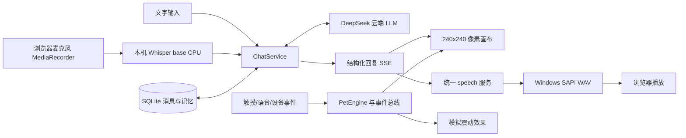

# PixelPet V1 架构

本机单主人、一个 Uvicorn 进程。SQLite 继续使用原五张表，补列迁移到 user_version=3；新增设置、提醒存入 pet_settings JSON，未重建数据库。

语音半双工：录音后停止麦克风，识别结束再请求 LLM，完成后合成并播放；播放中不自动录音，手动新录音会先停止播放。取消会中止前端请求并作代际检查，过期识别结果不得继续发给 AI；本机原生推理线程可能需要自行退出，期间拒绝叠加 ASR。

DeepSeek 收到当前文字、有界最近上下文和最多八条相关记忆。Whisper/SAPI 在 PC 本地执行，浏览器语音是独立可选路径，不等同于设备可用音频文件。原录音只在内存和受限临时上传目录中处理，不永久存储；报告中的 WAV 为显式合成测试样本。

统一 EventBus 保存有限元数据，不记录对话、音频、密钥。PetEngine 计算状态和模拟触觉效果，配置和安静时段由 PreferencesService 提供；提醒需服务和页面运行，默认主动问候关闭。

ESP32 代码为单独 guarded ESP-IDF 项目，hardware/pinmap.json 为唯一映射源，生成 firmware/main/board/pixelpet_pin_config.h。电脑模拟不依赖 GPIO。小智网关选择 B：另建原生协议网关，当前 PixelPet JSON WebSocket 不能代替小智 Opus 协议。详见 architecture_decision.md。
